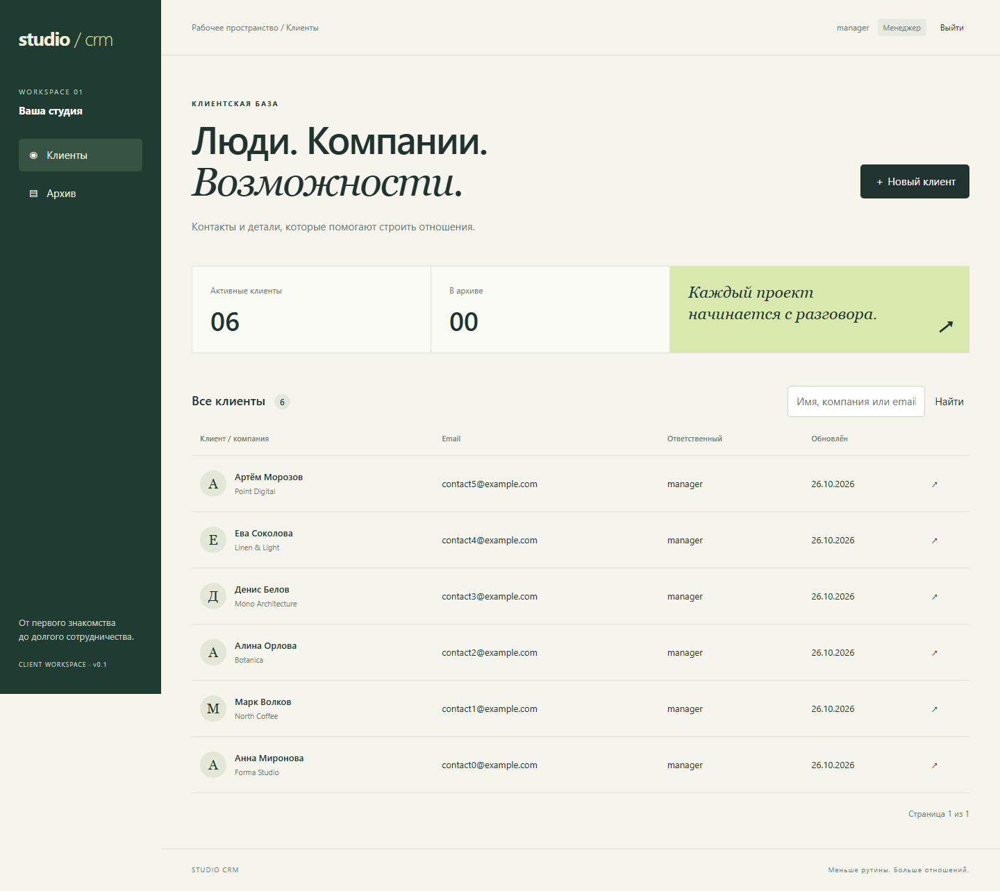
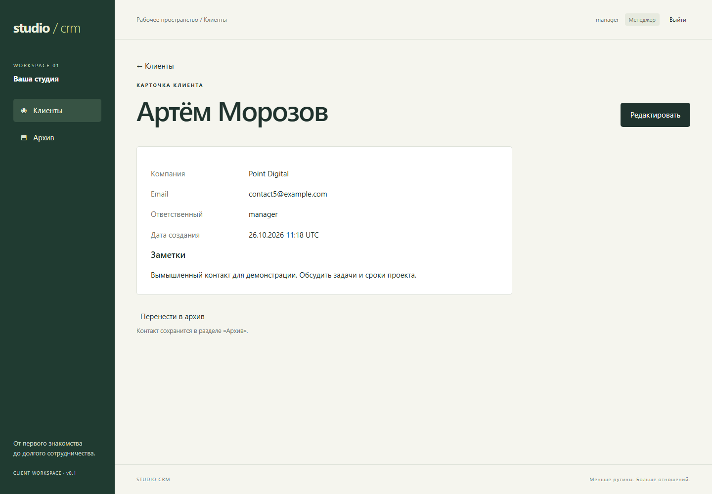
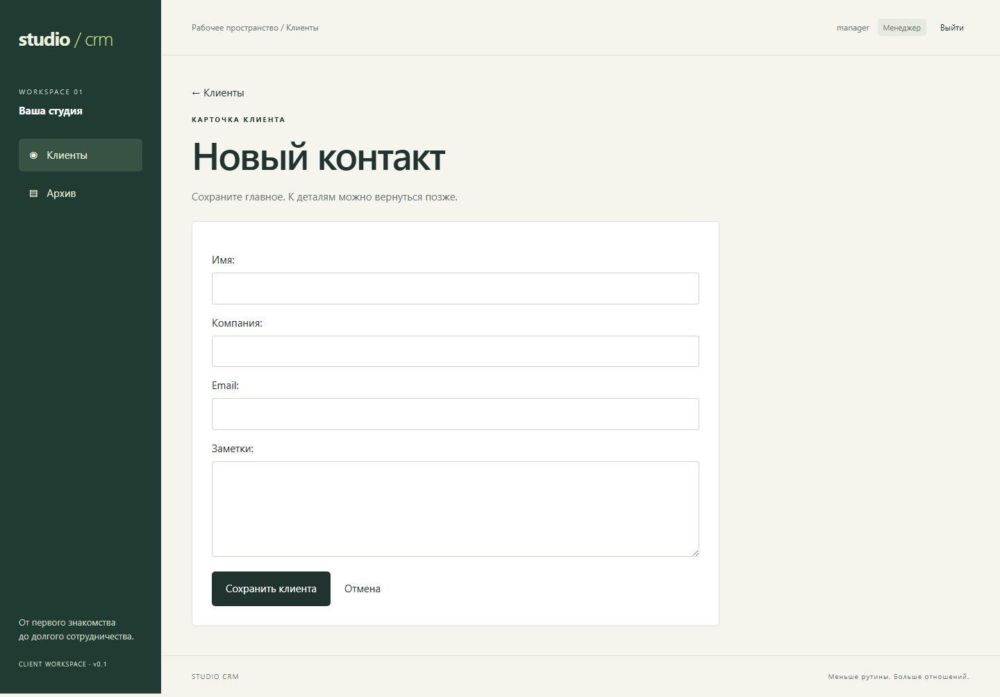
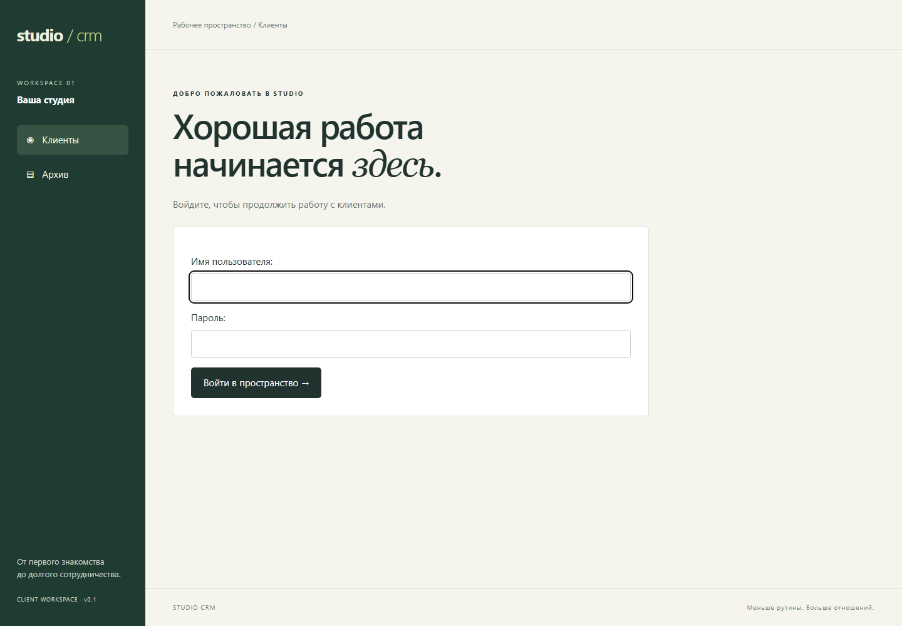
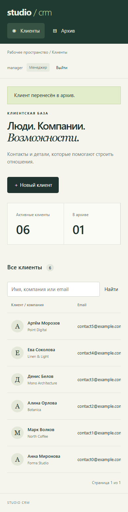

# Studio CRM — рабочее пространство для клиентов

[](https://github.com/httpeacex/studio-crm/actions/workflows/ci.yml)

**От первого знакомства до долгого сотрудничества.**

CRM для небольшой студии: контакты, компании и контекст общения в одном месте.
Проект для портфолио с реальной серверной логикой, базой данных и проверкой прав.



[Возможности](#что-уже-работает) · [Дизайн](#как-выглядит-приложение) · [Запуск](#быстрый-запуск) · [Проверки](#проверки) · [Планы](docs/roadmap.md)

## Что уже работает

Первый рабочий этап — управление клиентами. Сделки, задачи и аудит запланированы,
но пока не реализованы. Публичная демоверсия пока не развёрнута.

- Вход и выход через Django sessions.
- Создание и редактирование клиента, заметки, архивирование.
- Поиск по имени, компании и email; пагинация по 12 клиентов.
- Менеджер видит своих клиентов; руководитель (`is_staff`) — всю команду.
- Проверка прав на чтение и каждое изменение на сервере.
- Русский адаптивный интерфейс, состояния пустого списка и ошибок.
- Вымышленные демонстрационные данные и интеграционные тесты.

### Пример использования

Вы ведёте небольшую веб-студию. Новый заказчик написал о проекте: добавьте его
контакты, укажите компанию и сохраните детали разговора в заметках. Позже найдите
его через поиск, обновите информацию или перенесите контакт в архив.

| Пользователь | Что видит и редактирует |
|---|---|
| Менеджер | Только своих клиентов |
| Руководитель | Клиентов всей команды |

## Как выглядит приложение

Тёмно-зелёная навигация, светлый фон и спокойные акценты. Основное внимание —
контактам, поиску и действиям. Все изображения ниже сняты с работающего приложения
на вымышленных данных.

### Карточка клиента

Компания, email, ответственный и заметки собраны на одной странице.



### Добавление контакта и вход

<table>
  <tr>
    <td width="50%"><br><strong>Новый клиент.</strong> Четыре поля, проверка ввода и сохранение в базе.</td>
    <td width="50%"><br><strong>Вход.</strong> Рабочее пространство доступно после авторизации.</td>
  </tr>
</table>

<details>
<summary><strong>Мобильная версия — открыть скриншот</strong></summary>

Навигация перемещается наверх, блоки перестраиваются под узкий экран.
Таблица прокручивается горизонтально внутри своего блока.



</details>

## Технологии и решения

Python 3.12 · Django 5.2 · SQLite · HTML/CSS · GitHub Actions.

Серверный рендеринг сокращает количество движущихся частей в первой версии.
SQLite позволяет запускать проект без внешних сервисов. PostgreSQL и REST API —
возможные следующие этапы, когда появятся соответствующие требования.

## Быстрый запуск

Понадобятся **Python 3.12** и **Git**. Отдельный сервер базы данных для локального запуска не нужен.

```bash
git clone https://github.com/httpeacex/studio-crm.git
cd studio-crm
python -m venv .venv
```

Активировать окружение:

```powershell
# Windows PowerShell
.\.venv\Scripts\Activate.ps1
```

```bash
# macOS / Linux
source .venv/bin/activate
```

```bash
pip install -r requirements.txt
python manage.py migrate
python manage.py seed_demo
python manage.py runserver
```

Открыть <http://127.0.0.1:8000/>. Команда `seed_demo` выводит случайные пароли
для `manager` и `director` только при создании аккаунтов. Повторный запуск
сохраняет существующие пароли и пропускает контакты с прежними демонстрационными email.
Если изменить email демонстрационного клиента, повторный запуск создаст исходный контакт заново.
Для сброса своего локального пароля: `python manage.py changepassword manager`.

## Демонстрация за две минуты

1. Войти под `manager`, найти клиента по компании.
2. Создать контакт, открыть карточку, добавить заметку.
3. Отредактировать email, обновить страницу и проверить сохранение.
4. Архивировать контакт и найти его в архиве.
5. Войти под `director` и проверить доступ к клиентам команды.

## Проверки

```bash
python manage.py check
python manage.py makemigrations --check --dry-run
python manage.py test
```

Тесты проверяют полный цикл клиента, фильтрацию, серверную изоляцию менеджеров,
доступ руководителя, ошибки формы, POST-only архивирование, CSRF и экранирование HTML.

## Структура проекта

```text
config/                 Django settings and routes
crm/models.py           Client data and owner relationship
crm/forms.py            Validated editable fields
crm/views.py            Access-scoped queries and request handlers
crm/templates/crm/      Server-rendered screens
crm/static/crm/         Responsive visual design
crm/management/         Local demo data command
crm/tests.py            Integration tests against a real test database
docs/                   Architecture and roadmap
.github/workflows/      Continuous integration
```

## Статус и ограничения

Quick start запускает локальную разработку. Для публикации нужны отдельные настройки
HTTPS, WSGI/ASGI-сервера, раздачи static, базы, резервного копирования и ограничения
попыток входа. Настройки берутся из переменных окружения; `.env.example` служит
примером и автоматически не загружается. При `DJANGO_DEBUG=0` требуется уникальный
`DJANGO_SECRET_KEY`; secure cookies и HTTPS redirect включаются автоматически.
`seed_demo` работает только при включённом DEBUG. Секреты и локальная база исключены из Git.

Текущие ограничения: одна команда; `is_staff` объединяет роль руководителя и staff-флаг
Django; параллельное редактирование использует последнее сохранение; восстановление
из архива и защита от повторного создания клиента будут добавлены отдельно.

Следующий этап — **сделки и доска продаж**, затем задачи, история изменений и отчёты.
Полный план: [дорожная карта](docs/roadmap.md). Технические решения: [архитектура](docs/architecture.md).

Автор: [@httpeacex](https://github.com/httpeacex).
