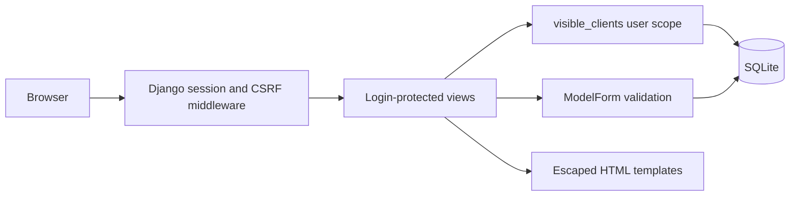

# Architecture

## Scope

One studio, several managers, one shared database. This is a portfolio application
at the client-management milestone, not a production SaaS or multi-tenant system.

## Access rules

| Action | Manager | Supervisor |
|---|---|---|
| List / search / read | Owned clients | All clients |
| Edit / archive | Owned clients | All clients |
| Create | Owner assigned server-side | Owner assigned server-side |

All object lookups use the same scoped queryset. Foreign object IDs return 404.
The submitted form cannot choose an owner. Authenticated supervisors are identified
by `is_staff`; more granular groups and assignment permissions are planned.

## Data

Client belongs to a Django user with PROTECT deletion semantics. Archive is a flag,
preserving notes and ownership. Index `(owner, archived)` serves the main filter.
All timestamps are stored in UTC. Pagination has deterministic ordering by timestamp
and primary key. Current SQLite search does not guarantee Unicode case folding.

## Tradeoffs

- Django templates provide one deployable application with built-in auth and CSRF.
- SQLite keeps local onboarding small; PostgreSQL will be considered for concurrency.
- Sessions keep authentication in HTTP-only cookies instead of browser storage.
- Archive is idempotent; client creation is not yet protected against double submits.
- Last save wins for concurrent edits; optimistic locking is a future milestone.

## Evidence

Integration tests run through Django's HTTP test client against a separate database.
CSRF is explicitly enforced in its dedicated test. Permission tests exercise read,
edit and archive with another user's session, rather than only checking the UI.
